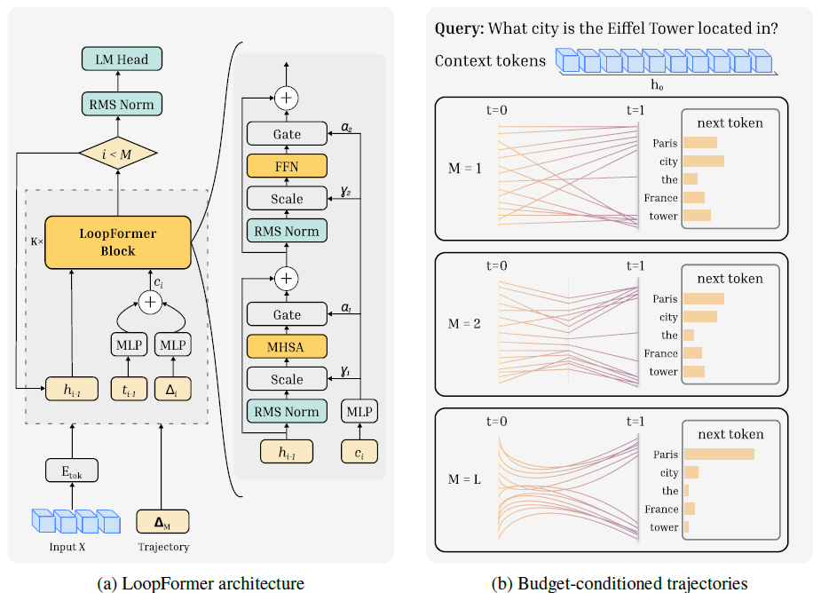

# LoopFormer



*Figure from the authors' repository, [armenjeddi/loopformer](https://github.com/armenjeddi/loopformer) (MIT License, © 2026 Ahmadreza Jeddi).*

An independent reimplementation of the LoopFormer ([Jeddi, Ciccone, Taati, 2026](https://arxiv.org/abs/2602.11451); the authors' code is at
[armenjeddi/loopformer](https://github.com/armenjeddi/loopformer)): a decoder-only transformer with k unique blocks applied L times, each loop conditioned on
its position in the journey, and trained so that fewer loops still give a useful answer. Built out of own implementation of model components from my
[CS336 assignment 1](https://github.com/pjurczen/cs336-assignment1-basics) (the same attention with QK-norm, RoPE, SwiGLU, tied embeddings, Muon and AdamW),
so its results compare directly with the plain transformer trained there. A curiosity project, not part of the assignment.

How to run it, the layout of the code and the flags: [docs/usage.md](docs/usage.md).

## What differs from a plain transformer

- **Looping.** k blocks are shared and applied L times. A trajectory is a list of step sizes that sum to 1, each a multiple of 1/L: the long route is L steps of
  1/L, and a shorter route takes bigger steps.
- **Conditioning.** Each loop gets a vector c computed from the time t reached so far and its own step size, through fixed sine/cosine features and a small MLP
  each. Inside a block, c sets the scale after each RMSNorm, (1 + γ), and gates each residual branch, α. The modulator starts at zero, so a fresh block passes
  its input through unchanged.
- **Training.** Every step runs the long route and one sampled shorter route: loss = CE_long + 0.1 · CE_short + 0.1 · MSE(stopgrad(h_long), h_short), so a
  short route learns to land where the long one lands.
- **Elastic depth.** The trained model runs at any loop count M ≤ L. `evaluate.py` measures the loss at every M, `decode.py` generates text at a chosen M.

## Improvements over the paper's implementation

Three changes to how the model is trained, none to what it computes; each is measured in [docs/results.md](docs/results.md).

- **Two backward passes instead of one.** The paper runs one backward through both routes' activations. Here the long route runs forward and backward first,
  its final hidden state is detached as the consistency target, then the short route runs. The gradient of a sum is the sum of the gradients, so the update is
  the same, at about half the peak memory.
- **The whole forward compiles, one graph per loop count.** The reference repository trains without `torch.compile`, because a schedule given as a Python
  list makes every schedule a new graph. Here the schedule is a tensor input, and compiling the whole forward lands on the plain model's memory (37 GB against
  46 GB at batch 64 with each block compiled on its own). A `torch.while_loop` version, one graph for every loop count at a third of the peak memory and 15%
  more time per step, was measured and then removed ([comparison](docs/results.md#compile-scope-the-same-model-three-ways-to-compile-it)).
- **Gates alone condition the block.** adaLN-Zero's (1 + γ) scales do no measurable work: a block with the gates and without the scales matches the full
  modulation within noise at every loop count and halves the gradient bursts of early warmup
  ([ablations](docs/results.md#ablations-lighter-ways-to-condition-the-shared-block)). That block is the model here; the full modulation lives on in the
  result tables.

## Data

Two corpora, tokenized with the BPE tokenizer of [the assignment](https://github.com/pjurczen/cs336-assignment1-basics) (`cs336_basics/bpe_tokenizer.py`,
trained on the training split, `<|endoftext|>` the only special token):

| Name              | Corpus                                                                                                                          | Vocabulary |
|-------------------|---------------------------------------------------------------------------------------------------------------------------------|------------|
| `tinystories-10k` | [TinyStories V2, GPT-4 version](https://huggingface.co/datasets/roneneldan/TinyStories): `TinyStoriesV2-GPT4-{train,valid}.txt` | 10,000     |
| `owt-32k`         | [OpenWebText sample](https://huggingface.co/datasets/stanford-cs336/owt-sample): `owt_{train,valid}.txt.gz`                      | 32,000     |

```sh
# in the assignment repo
wget https://huggingface.co/datasets/stanford-cs336/owt-sample/resolve/main/owt_train.txt.gz && gunzip owt_train.txt.gz
wget https://huggingface.co/datasets/stanford-cs336/owt-sample/resolve/main/owt_valid.txt.gz && gunzip owt_valid.txt.gz
uv run cs336_basics/bpe_tokenizer.py train  --input owt_train.txt --vocab_size 32000 --out_dir tokenizers/owt-32k    # ~1 h for the 11.9 GB
uv run cs336_basics/bpe_tokenizer.py encode --tokenizer_dir tokenizers/owt-32k --input owt_train.txt --output data/owt-32k/train_ids.npy
uv run cs336_basics/bpe_tokenizer.py encode --tokenizer_dir tokenizers/owt-32k --input owt_valid.txt --output data/owt-32k/valid_ids.npy
```

The same with `TinyStoriesV2-GPT4-{train,valid}.txt` and `--vocab_size 10000` gives `tinystories-10k`. Link or copy `data/` and `tokenizers/` into this
repository (git ignores both). Any other corpus and tokenizer work in the same two file shapes: [docs/usage.md](docs/usage.md#data-and-tokenizers).

## Autoresearch

`autoresearch.md` is the program for an agent that tests the ideas of [ideas.md](ideas.md) on its own, after
[Karpathy's autoresearch](https://github.com/karpathy/autoresearch): one change, one 10-minute run on the Mac's GPU, one number, keep or `git reset`, all
night. `configs/mps-10min.sh <run_name>` is the fixed experiment it runs (TinyStories, 4 blocks × 2 loops at d_model 384, inductor-compiled on MPS at ~12K
tokens/s), and `CLAUDE.md` hands the agent the program. Start a fresh Claude Code session in the repository root and say: "Read autoresearch.md and set up a
new experiment run; after setup, start the loop."

## Results

Validation loss in nats per token on OpenWebText (context 512, d_model 768, the 32K tokenizer), one GPU, fixed wall-clock. The plain model is the
assignment's 12-layer transformer; the LoopFormer applies 6 blocks twice, the same compute per token with 58M instead of 85M weights. Its training step runs
two routes, 1.4× the cost of a plain step, so in the same minutes it sees 62–77% of the tokens.

| Budget            | Plain 12-layer | LoopFormer 6×2 | Gap   |
|-------------------|----------------|----------------|-------|
| 15 min, A100-80GB | 3.693          | 3.831          | 0.14  |
| 45 min, B200      | 3.191          | 3.346          | 0.155 |

- **Looping does not pay at equal time**, and more training does not close the gap. Among looped shapes, more unique blocks win: 6×2 > 4×3 > 3×4 > 2×6.
  The paper compares at equal tokens (Table 1) or equal training FLOPs (Appendix B.3), never at equal time, and still finds its looped models behind the
  non-looped one on perplexity.
- **Elastic depth works.** The 6×2 model at one loop gives 3.414 instead of 3.346; one loop fewer than L costs 0.01–0.03 on every shape.
- **Gates are enough.** Gates alone match the paper's full modulation; dropping the modulation costs 0.023; per-loop LoRA adds nothing.
- **The memory gap was the compiler.** Compiled block by block, the model kept twelve float32 softmax outputs (9.7 GB); compiled as one graph it keeps one,
  like the plain model.
- **Looped models need a longer warmup**: 500 steps against 120 at the B200's learning rate, with gradient bursts after it that clipping contained.

The tables, the memory breakdowns and the compile comparison: [docs/results.md](docs/results.md). What to try next, ranked and with sources:
[ideas.md](ideas.md).
