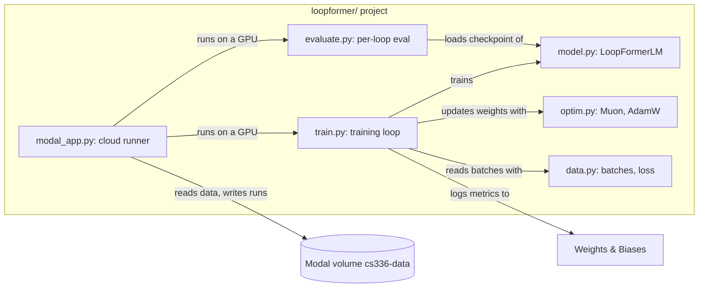
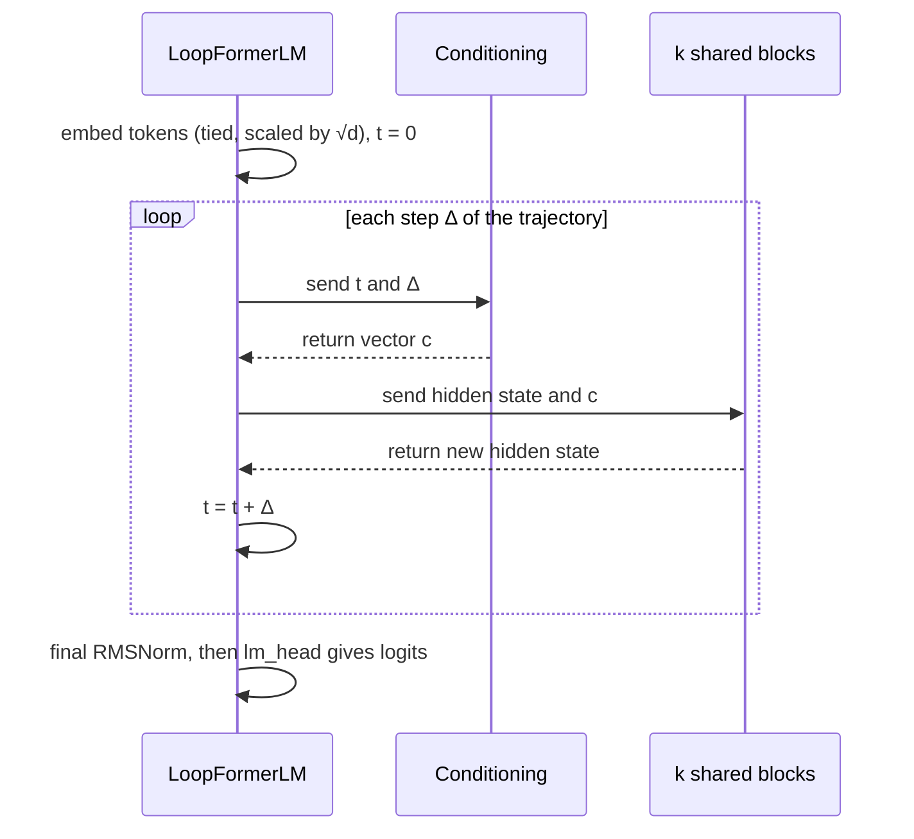
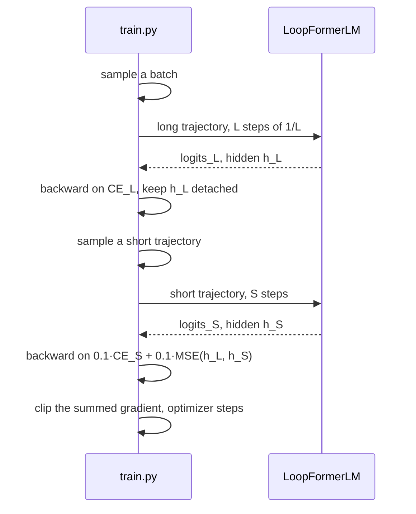

# LoopFormer experiment

## Context

The CS336 assignment is complete. The best OpenWebText model is a 12-layer, d_model 768 transformer with QK-norm. It reaches a validation loss of 3.191 in 45 minutes on one B200.

The user wants to try one more architecture, out of curiosity: the LoopFormer (arXiv 2602.11451). A LoopFormer applies one small stack of k blocks L times. Each pass is a loop. The model conditions each loop on its position in the trajectory, and training teaches it to give useful output after fewer loops. The experiment must answer three questions:

- Equal time: how does a looped model compare with the 12-layer baseline in the same wall-clock time?
- Elastic depth: how does the loss of one trained model change with the number of loops at inference?
- Parameter efficiency: how does a looped model compare with a plain model of the same parameter count?

This work is not for the assignment or the leaderboard. Claude writes all of its code. It lives in a new folder, `loopformer/`, on the branch `loopformer`.

## Decisions

- `loopformer/` is a complete project. It has its own `pyproject.toml` and `uv.lock`. Nothing in it imports from `cs336_basics`.
- The components come from the user's code as copies: `Linear`, `Embedding`, `RMSNorm`, RoPE, attention with QK-norm, SwiGLU, AdamW, Muon, the schedules, gradient clipping, the data functions, the loss, the text sampler and the encode and decode part of the BPE tokenizer. Only the import lines change, except in the tokenizer, whose encode and decode part is rewritten around the same algorithm. The results then compare directly with the runs in `runs/`.
- The tokenizer's training code (`train`, `pretokenize`, `BpeState`, the profilers) stays out. `tokenizer.py` loads `vocab.json`, `merges.txt` and `tokenizer_config.json` from a tokenizer folder and encodes and decodes text. It needs the `regex` package.
- The folder has no plain mode and runs no new baselines. The existing runs give every baseline.
- The runs execute on Modal only, on A100-80GB for screening and on one B200 for the final run. Local commands serve the tests and a short check on the Mac (`--device mps`).
- The training step computes the gradient in two backward passes, one per trajectory. The gradient of a sum is the sum of the gradients, so this gives the same gradient as the paper's single backward at about half the peak memory.
- Nothing outside `loopformer/` changes.

## Layout

```
loopformer/
  README.md        what it is, how to run, results
  pyproject.toml   own environment: torch (CUDA 13 build on Linux), numpy, einops, wandb; dev: modal, pytest
  uv.lock
  model.py         copied components, the conditioning, the LoopFormer block and LoopFormerLM
  trajectory.py    the long route, the sampler for short routes and the evaluation schedule for a budget
  optim.py         copied AdamW, Muon, cosine schedules (step and wall-clock), gradient clipping
  data.py          copied get_batch, random and non-overlapping indices, cross-entropy
  checkpoint.py    copied save and load, with the Muon state
  run.py           a run folder: the settings in config.json, the newest checkpoint, the trained model
  tokenizer.py     BPE encode and decode, loaded from a tokenizer folder
  train.py         the training loop
  evaluate.py      the validation loss along a schedule (train.py uses it too) and the loss at every loop count
  decode.py        text generation from a checkpoint, at a chosen loop count
  modal_app.py     the cloud runner
  configs/         the shared flags and one submit script per phase (A100 screening, B200 run), taking the shape k L
  tests/
```

`pyproject.toml` pins the same torch as the main project (`~=2.11.0`), so the speed and the numbers stay comparable. The layout follows the nanoGPT convention of the reference code: flat files, one job each.

Which parts take part, and what each depends on:



Commands run from inside `loopformer/`: `uv run train.py ...`, `uv run pytest`, `uv run modal run --detach modal_app.py ...`. Training reads the existing `data/owt-32k/*.npy` files and the vocabulary size from `tokenizers/owt-32k/tokenizer_config.json`, both on the volume. Only `decode.py` loads the full tokenizer, from the path recorded in the run's `config.json`.

## The model (`model.py`)

`LoopFormerLM` has k unique LoopFormer blocks. One forward pass applies the stack of k blocks once per step of a trajectory. A trajectory is a list of step sizes Δ that sum to 1. The time t starts at 0 and grows by Δ after each step.

One forward pass for the trajectory Δ = (½, ¼, ¼):



The conditioning maps t and Δ to one vector c of size d_model. Each scalar goes through 256 sine and cosine features with a maximum period of 10,000, then through an MLP (256 → d → d, SiLU, with bias). The two results are added. All tokens and all k blocks of a step share c.

The LoopFormer block is the user's `TransformerBlock` with three changes:

1. The two RMSNorms have no learned weight. Their output is multiplied by (1 + γ).
2. A gate α multiplies each residual branch before the add: x ← x + α · attention(...), and the same for SwiGLU.
3. A modulator, SiLU then a linear layer with bias, maps c to (γ₁, γ₂, α₁, α₂). Its weight and bias start at zero. At step 0 every gate is 0, and the block passes its input through unchanged.

RoPE, QK-norm, SwiGLU with d_ff 2048, the tied embeddings with √d scaling, the final RMSNorm with its learned weight and the `Linear` initialization stay as in the user's model. QK-norm and the tied embeddings are always on, with no flag. RoPE applies in every loop at the same positions.

Size at d_model 768: one block has 7.1M weights and its modulator adds 2.4M. The two conditioning MLPs add 1.6M in total. A 3×4 model has about 30M weights outside the embeddings. The 12-layer baseline has 85M, at about the same compute per token.

The 2-D matrices inside the blocks, the modulators included, go to Muon. The conditioning MLPs, the embeddings and the norm weights go to AdamW. This is the split rule of `cs336_basics/train.py`.

`torch.compile` compiles each block, not the whole model. The values t and Δ enter as tensors. Trajectories of different lengths then reuse one compiled block.

*Amended 2026-11-05, after measurement:* the per-block compile keeps all twelve float32 softmax outputs for the backward pass (46 GB at batch 64 against the plain model's 37 GB). With the schedule as a tensor input, the whole forward compiles as one graph per loop count and reaches the plain model's memory at no speed cost, so `--compile whole` is the default. A `torch.while_loop` variant (`--compile loop`) needs one graph and a third of the memory, at 15% more time per step. See the README's "Compile scope" section.

## The training step (`train.py`)

`train.py` keeps the structure of `cs336_basics/train.py`: the wall-clock cosine schedule with warmup, the time budget with its reserve, the Muon and AdamW split, gradient clipping, bf16 autocast, validation during training, the final full-set validation, checkpoints, `metrics.jsonl`, wandb and the git commit. The loss of one step changes:



- The paper and the reference code add the three terms and call one backward. The gradient of a sum is the sum of the gradients, and `h_L` is detached, so two backward calls accumulate the same gradient into `.grad`. The reference code relies on the same accumulation across its micro-batches.
- The short trajectory has a length S drawn uniformly from 1 to L − 1. Each step is a multiple of 1/L, and the steps sum to 1. This is the sampler of the reference code. For L = 4 and S = 2, the options are (¾, ¼), (½, ½) and (¼, ¾).
- The consistency term is the mean squared error between the hidden states after the final RMSNorm, as in the reference code. Those states have unit RMS, so the weight 0.1 has a stable meaning. The long trajectory's states are detached. The term pulls the short trajectory toward the long one and never the reverse.
- `train_loss` is the cross-entropy of the long trajectory. It compares directly with the baselines. The short cross-entropy and the consistency term are logged as `short_loss` and `consistency_loss`.
- Validation always uses the full L-step trajectory. Its `val_loss` means the same as in the baselines.
- Flags: `--loop_blocks` (k), `--loop_max` (L, at least 2), `--shortcut_weight` (0.1) and `--consistency_weight` (0.1). `--tokenizer_dir` stays: training reads the vocabulary size from its `tokenizer_config.json` and records the path in `config.json`, so a checkpoint names its tokenizer and `decode.py` loads it from there. The flags for z-loss, the logit cap, QK-norm, tied embeddings and the layer count do not exist. The other flags match `cs336_basics/train.py`.
- Run names follow the existing pattern and name the dataset, the GPU and the shape, e.g. `owt-a100-loop-3x4-20min`.

Each step applies the stack about 1.5 × L times, because the short trajectory averages L/2 loops. In equal time the model sees fewer tokens than a plain model of the same depth. The logged `tokens` value is steps × batch × context: the same batch feeds both trajectories.

Peak memory is about one long trajectory: roughly 38 GB for 3×4 at batch 64, close to the 37 GB of the 12-layer baseline. It fits on an A100-80GB.

## Per-loop evaluation (`evaluate.py`)

`evaluate.py` loads a run's `config.json` and its last checkpoint. It measures the loss on the whole validation set once for each loop count M from 1 to L. For M steps it splits the L grid units of 1/L into M steps as evenly as possible, with the larger steps first. For L = 4 and M = 3 the schedule is (½, ¼, ¼). Every step lies on the grid the model trained on. Uniform steps of 1/M leave the grid when M does not divide L, and the paper reports that coarse steps early and fine steps late work best. It writes `budget_eval.json` into the run folder and prints a table of M, loss and time per batch.

## Text generation (`decode.py`)

`decode.py` is a copy of `cs336_basics/decoding.py` for the looped model. It loads a run's `config.json`, its last checkpoint and the tokenizer named in the config, then reads prompts from the terminal and prints the generated text token by token. The sampler keeps temperature, top-p and top-k.

- `--loops M` picks the loop count at inference, default L. The schedule for M comes from the same rule as in `evaluate.py`, so a prompt can be tried at several budgets and the outputs compared.
- `--schedule` takes an explicit list of step sizes, e.g. `0.5,0.25,0.25`, and overrides `--loops`.
- It runs locally on the Mac (`--device mps` or `cpu`) on a checkpoint fetched from the volume with `modal volume get`. A checkpoint of a 3×4 model is a few hundred MB.

## The cloud runner (`modal_app.py`)

`modal_app.py` is adapted from `scripts/modal_train.py`:

- The image is built from `loopformer/pyproject.toml` and `loopformer/uv.lock`. The folder's `.py` files and `configs/` are uploaded.
- It uses the volume `cs336-data` and the secret `wandb`. The GPU type comes from the `GPU` environment variable (default `A100-80GB`), fixed before the app is built, so Modal's dashboard shows the GPU a run uses.
- One function runs `train.py` and then `evaluate.py` on the final checkpoint in the same container. The per-loop evaluation runs after the time budget ends.
- Results go to `runs/<run_name>/` on the volume.
- The hard stop is 75 minutes, for a 45-minute B200 run plus the evaluation.

## The runs

Phase 1 runs on A100-80GB. The shared settings are those of the round-2 QK-norm run at learning rate 4e-3 and floor 4e-4: d_model 768, 12 heads, d_ff 2048, context 512, batch 64, Muon, bf16, tied embeddings, warmup 120, weight decay 0.1. The time budget is 20 minutes with a 5-minute reserve.

| Shape (k × L) | Effective depth | Weights outside embeddings |
|---|---|---|
| 3×4 | 12 | ~30M |
| 4×3 | 12 | ~38M |
| 6×2 | 12 | ~59M |
| 2×6 | 12 | ~21M |

All four shapes have the compute per token of the 12-layer model. A 3-minute smoke run on an A100 precedes them and checks the whole path.

The comparisons use these references:

- Equal time: the 12L/768 QK-norm run at 4e-3, validation loss 3.693 (`runs/a100/owt-a100-80gb-12l-qknorm-lr-4e-3`).
- Elastic depth: each run's own `budget_eval.json`.
- Parameter efficiency: 6×2 (59M) against the plain 8L/768 run with weight decay 0.1 (57M, 3.669, `runs/a100/owt-a100-ctx512-8l-d768-20min-wd-0.1`). That run used a 40 GB A100, learning rate 2.8e-3 and no QK-norm, so the comparison is approximate. No plain run matches the smaller shapes, and the design runs none.

Every run logs steps and tokens next to time. A speed difference between Modal's and Vertex's A100 then shows in the numbers. The user decided against a calibration run of the 12-layer model on Modal.

If a shape diverges, it runs again with warmup 500 and learning rate 2e-3. The paper used a long warmup and calls it important for stability.

Phase 2 is one B200 run of 45 minutes with the best shape, against 3.191, with a reserve of 2 minutes. The baseline's batch 256 does not fit: phase 1 peaked at 46 GB at batch 64, which scales to about the B200's whole 180 GB. The run uses batch 192, about 140 GB, with the learning rate 6.9e-3 and floor 6.9e-4, sqrt-scaled from 4e-3 at batch 64. The result is stated next to that difference.

## Tests (`loopformer/tests/`)

All tests use a tiny model (2 blocks × 2 loops, d_model 64, vocabulary 100, context 16) and run on the CPU in seconds. They test behavior, not structure.

- Overfit one batch: 200 training steps on one fixed batch drive the long trajectory's loss below 0.05, from ln 100 ≈ 4.6. The loss at M = 1 falls low too, which shows that the consistency training makes one loop approximate the full route.
- Greedy decode reproduces the memorized text: from the overfit model, `decode.py` continues the first tokens of that batch and returns the rest exactly, at M = L and at M = 1.
- No leakage from the future: a change of the token at position j leaves the logits before j unchanged, for every M.
- Zero-init behaves as designed: at initialization, one backward gives zero gradient to the attention and SwiGLU weights and non-zero gradient to the modulators, the embeddings and the final norm. After a few optimizer steps every parameter has a non-zero gradient.
- Checkpoint round-trip: save, load into a fresh model, identical logits for every M.
- Trajectories are valid: sampled short routes have 1 to L − 1 steps on the grid with a sum of 1, and the evaluation schedule for each M has M steps on the grid, larger first.

- The tokenizer round-trips text, keeps a special token as one id and applies merges in rank order, on a tiny tokenizer folder the test builds (the 256 byte tokens and three merges).

There is no equivalence test against `cs336_basics`. The copies are reviewed by eye.

## Failure handling

- Out of memory on the A100: the run fails in the first step and costs almost nothing. The fix is a smaller batch with a √-scaled learning rate, noted in the run name.
- A run that diverges: training logs the gradient norm at every log step. The final validation still runs when the loss is NaN, so the run folder shows what happened. The rerun settings are in "The runs".
- A crash in the per-loop evaluation: it runs after the checkpoint and the results are on the volume. `modal_app.py` can run it again on its own for a run name.

## Out of scope

- A plain (non-looped) mode and new baseline runs.
- A `--no_split_backward` switch, a gradient-equality test and comparison runs for the two-backward step.
- Changes to `cs336_basics`, `scripts/` or the Vertex image.
- Downstream reasoning benchmarks from the paper.
